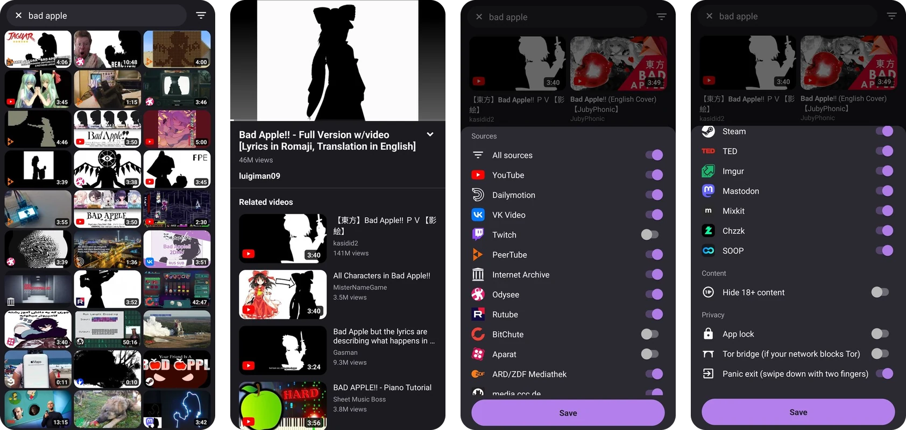

<p align="center"></p>

# Orvid

Android video player that searches many video sites at once and sends every request over Tor. Sources come from repositories you add.

<p align="center"></p>

- **Tor built in.** Orvid starts its own Tor client and gives each source and each video its own circuit. Requests wait until Tor is connected. If your network blocks Tor, turn on a bridge (obfs4, Snowflake or meek) under Privacy in the filter panel.
- **Sources from repositories.** Orvid ships with no sources. Add a repository to search YouTube, Dailymotion, VK, Twitch, PeerTube, Internet Archive, Odysee, TED and more at once, merged and ranked together. Adult sources live in a separate repository and stay hidden until unlocked with a gesture and an age check (spread two fingers apart on the main screen, then turn them on in the filter panel).
- **Fast start.** Orvid resolves the videos you are likely to open and fetches their first seconds while you browse, so videos start sooner.
- **Privacy tools.** Optional app lock with fingerprint or PIN that also hides the app in recent apps, and a panic exit: swipe down with two fingers to close Orvid and wipe its memory.
- **Memory only.** Orvid does not record what you watch, and thumbnails stay in memory. Closing the app clears its cache and cookies and stops Tor. Tor's relay list is kept on the phone so the next start connects faster.

## Scope

Orvid's goal is one private search box for videos from across the web. Any site with public videos fits: Orvid searches it and plays the videos straight from the site, through Tor.

[Performance by version](docs/PERFORMANCE.md) compares search quality and start times across releases.

## Staying fast over Tor

Every new Tor connection costs seconds. These are the methods Orvid uses, with numbers measured on a phone over Tor. They work for any app that talks to many sites through Tor.

- **Connect while the user types.** On the first letter, Orvid opens a connection to each source on that source's own circuit, and the search reuses it. A first request on a fresh circuit took 1.8-2.4 s, the same request on an open connection 0.6-0.8 s.
- **Show each source as it answers.** Results go on screen as soon as the first sources reply, and later ones are merged in, so one slow site never holds the list back.
- **Retry on failure, not on slowness.** When a source's first exit fails right away, Orvid tries a second exit at once. Sending a backup request just because a source is slow made things worse: in two runs with about 70 sources at once, the median reply took 5.1 and 4.8 s with a backup after 2.5 s, and 4.3 and 3.4 s without.
- **Fetch the smallest page that has the video.** Many sites have an embed page with the same video link. Reading it instead of the full page cut 175 KB to 4-10 KB, and finding the link went from 17-23 s to 3-6 s.
- **Give up early on servers that block Tor.** A media server that fails to answer twice is skipped for 10 minutes, so the next video on it fails in seconds instead of after 45.
- **Load thumbnails at the size shown.** For list rows Orvid asks YouTube for the 480 px cover instead of the 1280 px one: 12 covers went from 1.9 MB to 220 KB.
- **Skip dead sources.** A source that keeps failing while others work is tried again only every 6 hours.

## Getting started

Search once and tap **Add repository**, or open Filters → Repositories → Add repository, and paste:

```
https://raw.githubusercontent.com/mankidev/orvid-sources/main/
```

[orvid-sources](https://github.com/mankidev/orvid-sources) explains the source format, so you can write sources for other sites.

## Download

Get the APK from [Releases](https://github.com/mankidev/orvid/releases/latest), or add Orvid to Obtainium to get updates:

<a href="https://apps.obtainium.imranr.dev/redirect?r=obtainium://add/https://github.com/mankidev/orvid"></a>

Requires Android 8.0+.

## Build

On Android with [Termux](https://termux.dev):

```sh
pkg install openjdk-21 aapt2 apksigner zip unzip
./tools/fetch.sh
./build.sh
```

The APK lands in `build/orvid.apk`, signed with a local debug key. For a release build, point `ORVID_SIGNING_ENV` at a file that sets `ORVID_KEYSTORE`, `ORVID_KEY_ALIAS` and `ORVID_KS_PASS`.

`libs/native` ships a prebuilt `libwhisper.so`. `tools/whisper/build.sh` rebuilds it from a pinned whisper.cpp commit.

## License

GPL-3.0-or-later. Third-party components are listed in [NOTICE](NOTICE).
