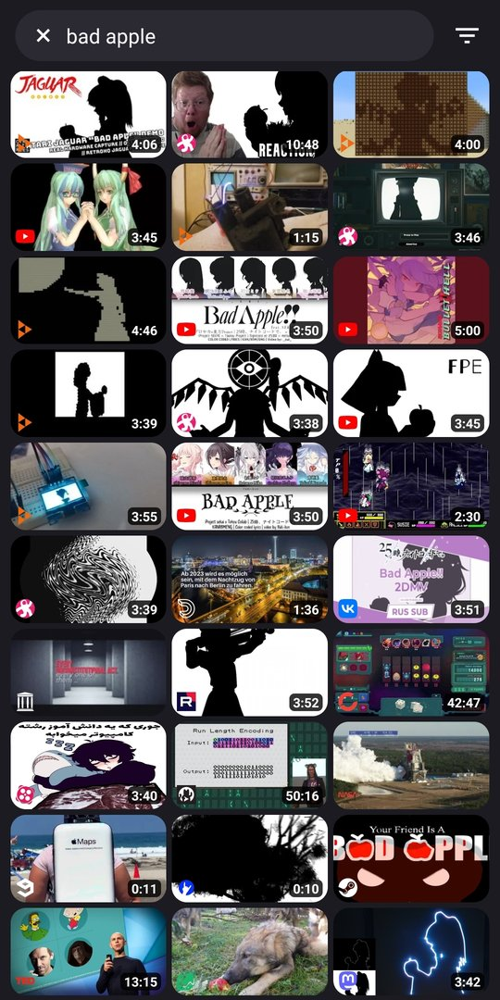
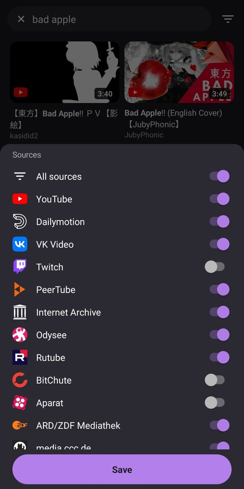
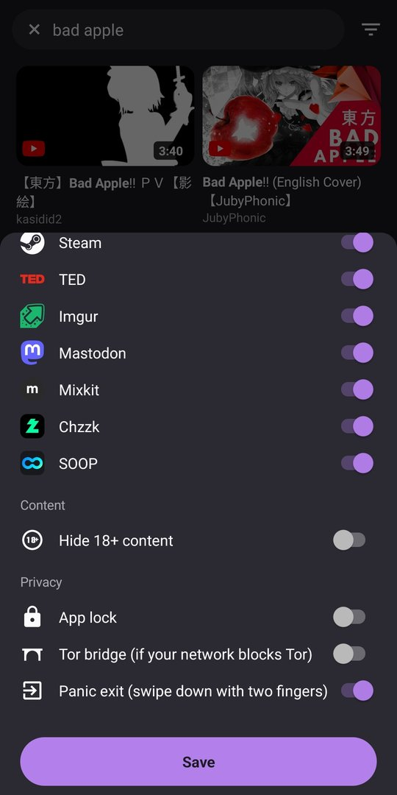

<p align="center"></p>

# Orvid

Android video player that searches YouTube and 50+ other sites at once and sends every request over Tor.

<p align="center">
  
  
  
  
</p>

- **Tor built in.** Orvid starts its own Tor client and gives each source and each video its own circuit. Requests wait until Tor is connected. If your network blocks Tor, turn on a bridge (obfs4, Snowflake or meek) under Privacy in the filter panel.
- **Search many sites.** YouTube, Dailymotion, VK, Twitch, PeerTube, Internet Archive, Odysee, Rutube, TED and more, merged and ranked together. Adult sources stay hidden until unlocked with a gesture and an age check (spread two fingers apart on the main screen, then turn them on in the filter panel).
- **Captions for any video.** whisper.cpp runs on the phone and writes captions for videos that have none. Translations go through Tor.
- **Privacy tools.** Optional app lock with fingerprint or PIN that also hides the app in recent apps, and a panic exit: swipe down with two fingers to close Orvid and wipe its memory.
- **Memory only.** Orvid does not record what you watch, and thumbnails stay in memory. Closing the app clears its cache and cookies and stops Tor. Tor's relay list is kept on the phone so the next start connects faster.

Requires Android 8.0+. Auto captions need an arm64 phone.

## Build

On Android with [Termux](https://termux.dev):

```sh
pkg install openjdk-21 aapt2 apksigner zip unzip
./tools/fetch.sh
./build.sh
```

The APK lands in `build/orvid.apk`, signed with a local debug key. For a release build, point `ORVID_SIGNING_ENV` at a file that sets `ORVID_KEYSTORE`, `ORVID_KEY_ALIAS` and `ORVID_KS_PASS`.

`libs/native` ships a prebuilt `libwhisper.so`. `tools/whisper/build.sh` rebuilds it from a pinned whisper.cpp commit.

## License

GPL-3.0-or-later. Third-party components are listed in [NOTICE](NOTICE).
